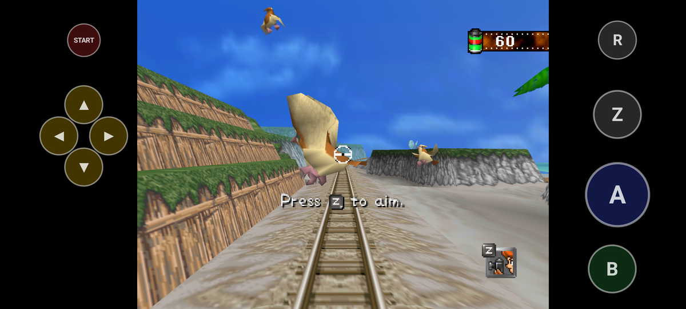

# Android (beta)

Snap64 Recomp runs on Android as a beta. The app is the same port as on a
PC: the game's own code, recompiled, drawn by RT64 through Vulkan, with the
same Options pages and the same mods. It has run on one phone, a Samsung
Galaxy S25 Ultra with a Snapdragon chip, and on Google's Android emulator.
It has not been played with a real pad yet. Everything below says what was
run and where; anything not listed is untried.

## What you need

* Android 10 or newer, on a 64-bit phone or handheld (arm64). A 32-bit
  phone cannot run it.
* A GPU with a Vulkan 1.2 driver. On a real device only Qualcomm's Adreno
  830 (the Snapdragon 8 Elite) has run the app. Other Adreno chips, Mali
  (most Samsung Exynos phones and Google's Pixels) and PowerVR are
  untried, and so is how fast the game runs on any other phone. A device
  whose driver offers less than Vulkan 1.2 is told so at start, in a
  dialog naming its GPU.
* Your own ROM of the US cartridge, as on a PC. The port checks it and
  refuses a wrong one.

The app also carries an x86_64 build, for Android's emulator.

## Installing

1. On the phone, download `Snap64Recomp-<version>-android.apk` from the
   [Releases](https://github.com/JackandBeans/Snap64Recomp/releases) page.
   That page is the only official download. The app is not in any store.
2. Open the file. The first time, Android asks you to turn on "Install
   unknown apps" for the app you downloaded it with (your browser or file
   manager). Turn it on, go back, and install.
3. Start Snap64 Recomp. The first start explains the game folder,
   **Internal storage > Snap64**, and asks for "All files access" to use
   it. **Allow** opens the system's setting: turn it on for Snap64 Recomp
   and go back. **Not now** uses the app's own folder instead,
   `Android/data/io.github.jackandbeans.snap64recomp/files`.
4. Give it your ROM. Either copy it into the Snap64 folder yourself (from
   a PC over USB, or with a file manager), named `pokemonsnap.z64`, or let
   the game ask: it opens the system's file picker, and the file you pick,
   whatever its name, is copied into the folder. `.z64`, `.v64` and `.n64`
   dumps all work.

An update installs over the app you have, and your saves stay. An update
must come from this project's own releases: Android installs it only over
an app signed with the same key. The APK is signed with that key on the
project's release machine, so unlike the other archives it carries no
GitHub build record; the `.sha256` beside it on the release page is the
check.

## The game folder

Internal storage > Snap64 holds what the port's own folder holds on a PC:
the ROM, `saves/`, `photos/`, `mods/`, `texture_packs/`, `snapsettings.json`
and `snap64.log`. A file manager or a PC over USB reaches it. Uninstalling
the app leaves this folder where it is. (With "Not now", the app's own
folder is used, and Android deletes that folder with the app.)

## Playing

The game runs full screen and stays in landscape. The system's Back
gesture or button opens the port's quit box.

Leaving the game is safe: Home, the recent apps, turning the screen off,
pulling down the notification shade or turning the phone around. The
game waits where it was, and its clock does not move while you are away.

### Touch controls

With no pad, the N64's buttons are drawn in the black bars beside the
picture, colored like the N64 controller's. A, B and Start are always
there. In a course, Z, R and the four C buttons join them.

* In a course, drag a finger on the picture to aim, and press A to take
  a photo.
* Tap Z to zoom in. Z stays held, drawn lit with a second ring, so the
  same thumb can go to A. Tap Z again to zoom out. Hold Z instead and it
  zooms only while held, as on the N64. With Options > Controls > Z
  Button set to Switch, Z is a plain button: the game zooms in or out at
  each tap, as it does with a pad.
* R, the dash, works the same way: a tap starts the dash and the next tap
  stops it, and a hold dashes only while held. The game dashes only while
  R is down, and on a phone R shares the thumb with A.
* The first finger that moves on the picture aims, until it lifts. A thumb
  resting on the picture or holding the phone's edge never takes the aim,
  and while one finger aims, another does not move the view.
* Mouse Speed, Zoom Speed and Camera Tilt on the Controls page apply to
  the drag.
* Outside a course, tap a menu item to choose it.

A press on a button can be felt when the phone's Touch feedback setting
is on, and the moment the game takes a photo is felt firmer. Each button takes
touches over at least 48 dp (about a third of an inch), however small it
is drawn; where two buttons' squares overlap, the nearer button takes the
touch. The buttons hide when a pad or a keyboard is used and come back at
the next touch. They stay clear of Android's Back gesture and of a camera
cutout.

The first course after the app is installed shows one line over the
picture for five seconds: "Drag to aim. Tap Z to zoom. A takes the photo."

They have no Options rows yet. Three settings in `snapsettings.json` in
the game folder change them:

* `touch_controls`: 0 shows them until a pad or keyboard is used (the
  default), 1 always, 2 never.
* `touch_size`: their size in percent, 50 to 150 (default 100).
* `touch_opacity`: how solid they are in percent, 20 to 100 (default 60).

With Widescreen on, the picture fills the bars, so the buttons sit over
its outer edges. While they are shown, the film counter stays where the
cartridge puts it, even with Wide HUD on, so R does not cover it; with a
pad or a keyboard in use, Wide HUD moves it to the corner as on a PC.

On a 16:9 screen (1920 x 1080, as on many handhelds) the bars are
narrower than the buttons, so at the default size the left buttons reach
about 80 pixels into the picture and the right ones about 35. That is read
from the layout's arithmetic; no 16:9 screen has run it yet.

### Gyro aim

The phone itself can aim: turn it and the view turns with it, as a pad
with a gyro does on a PC.

* Options > Controls > Gyro Aim turns it on. Zoomed is the one to try
  first: the phone aims only while zoomed in, so you raise it to aim, as
  with a camera. On aims whenever a course runs.
* Gyro Speed scales the turn; Camera Tilt flips the up and down.
* Left and right are measured about the way up, which the phone's own
  accelerometer gives, so a phone held tilted back still turns the view
  left and right.
* With Gyro Aim off, the app does not read the gyroscope at all. A pad
  with its own gyro is used in place of the phone's.

This has been checked on the emulator's virtual sensors only, with the
phone held upright in one landscape: a turn to the left and a raise of
the phone each turned the view as far as the readings said, and a still
phone turned nothing. The tilted hold and the other landscape are read
from the code. No hand has tried it on a phone yet.

### Pads

Pair a Bluetooth pad in Android's own Bluetooth settings first, or plug in
a USB one. It works as a pad does on a PC: the same layout, the same
Button Setup page, and Select opens the Options. The
[manual's Controls](MANUAL.md#controls) lists the buttons. A pad with sticks
is used in place of any device that has none.

This has been checked only with a pad made in software on the emulator,
which Android and the app take for a real one. No real pad has been tried
yet. A report from any pad and phone is welcome.

### Mods

Mods load as on a PC. Put a mod in the game folder's `mods/` folder, or
open the file with Snap64 Recomp from a file manager ("Open with"): it is
installed as a drop is on a PC. Texture packs install the same way; none
has been tried on Android yet. The Mods page's Install row opens the
system's file picker (untried).

## What has been tested

On a Samsung Galaxy S25 Ultra in Samsung's Remote Test Lab (Snapdragon 8
Elite, Adreno 830, Android 15), on Oct 21 2026: the boot, a mod's hooks,
a ride on the Beach with its photos scored as on the PC, the pacing, the
menus and the pages, the settings file, and the ROM chooser. That was
before the touch controls and the return from Home were added: everything
added since has run on the emulator only.

On Google's Android emulator (Android 15), on Oct 21 and 22 2026: all of
the above again, and also the return from Home, the screen off and the
other events above, the touch controls from the intro to a course,
quick taps, Z and R held by a tap and by a hold, Z in the game's Switch
mode, the shutter felt at the game's own photo, a resting
finger beside one that aims, the touch feedback as Android's vibrator
service records it, the 48 dp touch squares at the smallest size, the
first course's hint, Gyro Aim on the emulator's virtual sensors, a pad
made in software, and a display-size change.

[BUILDING.md, step 16](../BUILDING.md#16-android-cross-build-experimental)
has every run with its numbers.

Not tried yet:

* a real pad, Bluetooth or USB;
* the sound, heard by a person;
* the touch controls on a real screen, by a hand, and their feel;
* Gyro Aim with a phone's own gyroscope, in a hand;
* any GPU but the Adreno 830, and the speed on any other phone;
* Android 10 to 14 (both test devices ran Android 15).

## Known limits

* The Snap Station's print is not available. On a PC the port restarts
  itself twice for it, and an Android app cannot (read from the code, not
  tried).
* The touch controls have no Options rows yet (above).
* The Graphics page's Fullscreen row does nothing: the game is always
  full screen on Android.
* The phone's game tools may not shrink the picture or change the frame
  rate: the app offers Android's standard game mode only.
* The emulator draws slower than a phone, so a run there is slower than
  the game's own pace. That is the emulator, not the port.

## Reporting a bug

Open an issue on the
[repository](https://github.com/JackandBeans/Snap64Recomp/issues) with the
phone's model, its Android version, and `snap64.log` from the game folder
(Internal storage > Snap64). To attach the log, open the issue in the
phone's browser and pick the file from that folder, or copy it to a PC
over USB and drag it into the issue. Each start keeps the previous run's
log as `snap64.prev.log`: if the problem was in the run before, attach
that one too.
